

<a href="https://boazcohen.dev"></a>
<a href="https://github.com/BoazCohenJ/NoFocusSteal">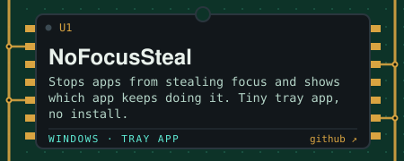</a><a href="https://github.com/BoazCohenJ/LoudLock">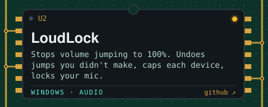</a>
<a href="https://github.com/BoazCohenJ/OutageLog">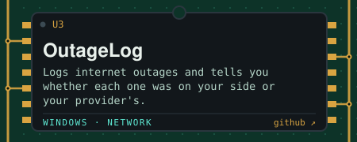</a><a href="https://github.com/BoazCohenJ/Cutcast">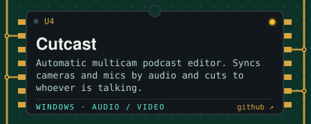</a>
<a href="https://github.com/BoazCohenJ/OpenCal">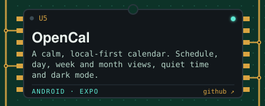</a><a href="https://github.com/BoazCohenJ/servermon">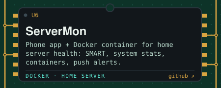</a>
<a href="https://github.com/BoazCohenJ/gmail-to-contacts">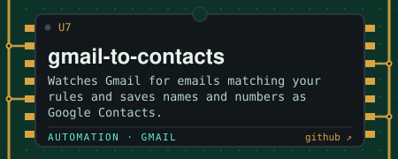</a><a href="https://github.com/BoazCohenJ/ESP32_OLED_Drawing">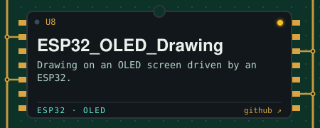</a>
<a href="https://boazcohenj.github.io/NoFocusSteal/">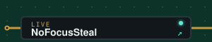</a><a href="https://boazcohenj.github.io/LoudLock/">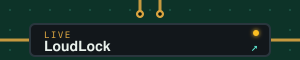</a><a href="https://boazcohenj.github.io/OutageLog/">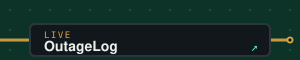</a>
<!-- REPOS:START -->
<!-- REPOS:END -->

